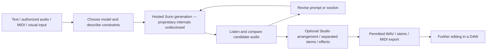

# A06 — Suno

Juna Kim · Alexandre Casanova · Sam Hoyek

[Public presentation](https://huskursa.github.io/CART498-GenAI/A06/slides/)

28 HTML slides covering setup, costs, the hosted workflow, training data, interaction, original creative examples, genre mixing, speech, sounds, stem separation, risks and project applications. Use arrow keys to navigate, F for fullscreen, O for overview and N for speaker notes.

## Creative documentation

The slides include nine local audio examples: four group genre-mixing tracks and five selected experimental examples. Eight separated stems share a live mixer on slide 18. An actual Ableton screenshot documents Sam’s import. Exact supplied prompts are available with Sam’s examples. The group’s settings screenshot documents one configuration; exact prompts and per-track settings for its four tracks were not supplied. Original group filenames and checksums are in slides/assets/audio/group/manifest.json.

Sources: supplied group PDF in documentation/genre-mixing-source.pdf; integration record in documentation/integration.md. Generated illustrations are clearly distinguished from software screenshots and audio results in the notes.

## Run the presentation locally

From this A06 folder, run python3 -m http.server 4387 and open http://127.0.0.1:4387/slides/. Keep the assets with the slides. A modern browser and headphones or speakers are sufficient. Internet access is required to use Suno; local presentation media is bundled.

## Group session

Plan one 30-minute session including at least eight minutes of live demonstration and questions. Use selected excerpts rather than playing every full track. The local files support playback without relying on Suno. A screen-recorded backup and final speaker allocation still need preparation; they are not claimed as completed.

## Scope and conceptual pipeline

Suno is a hosted generative audio service. Its current offering extends from full songs to individual parts, sounds, spoken audio, and multitrack production. This diagram describes an observable workflow, **not the internal model architecture**. Suno's current music models are proprietary; detailed internal architecture, parameter counts and training methods are undisclosed in the official sources consulted. Do not substitute the architecture of Suno's separate Bark project for the current music models.

The current family is v6, v6-wild and v6-mini. Suno markets v6 as controlled/polished and v6-wild as exploratory; these are product claims, not results of Sam's evaluation. v6-mini is free; the other two need Pro/Premier (Shulman 2026).

## Setup plan — target under 30 minutes

This is a proposed route, not a timed test. Login, queue delays, accessibility needs or an unavailable feature may take longer.

1. **0–5 minutes:** Open [Suno](https://suno.com), sign in or create an account, and check the active plan and credits. Use headphones or speakers. No local model installation or GPU is needed for this hosted workflow.
2. **5–10 minutes:** Open Create. For the basic demonstration, choose an available model and enter a short original prompt. Record the exact model, prompt, settings and date before generating.
3. **10–15 minutes:** Listen to both candidates, noting their actual lengths and differences. Preserve the outputs and their identifiers. Do not call an output successful merely because generation completed.
4. **15–20 minutes:** Change one prompt variable and compare. If using Pro/Premier, optionally demonstrate Sounds with a one-shot or loop, recording key/BPM settings.
5. **20–25 minutes:** If Premier is already available, open Studio and show an arrangement or a separated stem. Otherwise use the basic Create workflow; do not purchase a plan solely to complete this scaffold.
6. **25–30 minutes:** Save evidence and fill the experiment fields below. Check official download allowance before exporting. Keep a playable local fallback only where the plan and terms permit it.

### Account, hardware and compatibility

Suno account and internet connection required. Basic creation is available on web/mobile; this scaffold does not establish a minimum OS version. Studio requires Premier and a desktop/laptop/tablet with at least 768px screen width, SIMD-capable CPU (SSE4.1 or Neon), and 4GB RAM. Latest Chrome is recommended; Web MIDI is unavailable in Safari. Studio does not support conventional VST or Audio Units plugins. A microphone is needed only for recording; a MIDI controller is optional (Suno 2026d).

## Costs and production features

Prices below reproduce the site's displayed dollar amounts; the extracted page did not establish currency. Taxes extra; verify checkout currency before any purchase.

| Plan | Displayed price | Credits | Monthly song downloads |
|---|---|---|---|
| Free | $0 | 50/day | None included monthly |
| Pro | $10/month; $8/month billed $96/year | 2,500/month | 20 |
| Premier | $30/month; $24/month billed $288/year | 10,000/month | 60 |

Included credits expire each cycle; purchased top-ups require an active subscription. Current audio-upload comparison lists 8 minutes Free and 30 minutes Pro/Premier. Premier includes Studio (Suno n.d.c).

- **Sounds:** Pro/Premier one-shots and loops, effects, samples and ambience; experimental/beta. Key and BPM controls are available. Loops may include fuller musical arrangements (Suno 2026b, 2026f).
- **Speech:** Public beta since October 1, 2026; spoken audio with original music, on web/mobile. Do not promise clean standalone TTS, exact reading or voice consistency. Official announcement acknowledges accent and pause variability (Brody 2026).
- **Studio 2.0:** Audio/MIDI arrangement, effects, automation, synth and chat-created plugins. MIDI can be imported, recorded and edited (Phipps 2026).
- **MIDI in Create:** Added November 4, 2026 for Pro/Premier; .mid/.midi input uses Simple Create and v6-wild at launch. This is distinct from Premier Studio (Team Suno 2026).
- **Add Vocals:** User lyrics over an uploaded/generated instrumental; adherence is adjustable, not a guarantee of lossless preservation (Suno 2025).
- **Stems:** Auto Split up to 12 stems costs 50 credits, Pro/Premier. Split from Mix costs 10/stem, Pro/Premier. Advanced Split costs 10/stem, Premier. These are separated audio, not original recorded instrument tracks (Suno 2026c).
- **Export:** Studio offers mix, time range, multitrack stems and individual WAV clips. Stem-to-MIDI costs 10 credits. File availability depends on plan; WAV is paid/web and MIDI is Premier/Studio (Suno 2026a; Suno n.d.b).

## Rights and privacy considerations

Free outputs are personal/noncommercial. Paid output assignment does not guarantee copyright. Commercial use requires a permitted official download; user-enabled Remixes remain noncommercial irrespective of tier. Upload only material for which the required rights are held. Terms also grant Suno a broad license over submitted content (Suno 2026g).

The Privacy Notice says certain submissions, chat, content and activity are used to improve/train models. Voice features process recordings and voice characteristics. A private interface setting should not be treated as a training exclusion (Suno 2026e). These are research summaries, not legal advice or a claim that a particular output is cleared.

Account protection remains the user's responsibility. Suno generally stores information in the United States and may transfer it elsewhere. Sharing features and service providers can receive content. Retention depends on stated purposes. The Privacy Center accepts deletion requests with exceptions (Suno 2026e, 2026g).

## References — Chicago author-date

Brody, Jack. 2026. “Introducing Speech (beta).” October 1. https://suno.com/blog/introducing-speech-beta.

CART 498. 2026. “Oral Presentation: Generative AI Framework, Application, or Protocol.” Accessed November 5. https://moodle.concordia.ca/moodle/mod/assign/view.php?id=4616708.

Phipps, Henry. 2026. “Introducing Studio 2.0.” August 13. https://suno.com/blog/studio-2.

Shulman, Mikey. 2026. “Introducing v6.” September 9. https://suno.com/blog/introducing-v6.

Suno. 2025. “Add Vocals.” Updated July 21. https://help.suno.com/en/articles/6882817.

Suno. 2026a. “Exporting from Studio.” Updated September 9. https://help.suno.com/en/articles/13925249.

Suno. 2026b. “Make Loops and Samples from Scratch with Sounds.” January 27. https://suno.com/release-notes/make-loops-and-samples-from-scratch-with-sounds.

Suno. 2026c. “How Do I Get Stems?” Updated September 9. https://help.suno.com/en/articles/13925185.

Suno. 2026d. “Introducing Suno Studio 2.0.” Updated August 13. https://help.suno.com/en/articles/13670529.

Suno. 2026e. “Privacy Notice.” Modified June 23. https://suno.com/privacy.

Suno. 2026f. “Suno Sounds: Generate Custom Audio Samples.” Updated September 9. https://help.suno.com/en/articles/10625537.

Suno. 2026g. “Terms of Service.” Revised August 10; effective September 3. https://suno.com/terms.

Suno. n.d.a. “AI Music Generator.” Accessed November 5, 2026. https://suno.com/.

Suno. n.d.b. “What Types of Files Can I Download?” Accessed November 5, 2026. https://help.suno.com/en/articles/13926081.

Suno. n.d.c. “Pricing.” Accessed November 5, 2026. https://suno.com/pricing.

Team Suno. 2026. “Start Songs with MIDI.” November 4. https://suno.com/blog/MIDI-in-create.

Source limitation: some homepage/help prose retains older model information. Current model claims above follow the dated September v6 launch and live Pricing; plan/feature availability can change.

## Additional group research

Suno. 2026. “Suno – CA AB 2013 Disclosure.” January 1. https://help.suno.com/en/articles/9709569.

Suno. 2026. “Using Custom Models.” September 9. https://help.suno.com/en/articles/11362497.

Meta. n.d. “MusicGen: Simple and Controllable Music Generation.” Accessed November 5, 2026. https://github.com/facebookresearch/audiocraft/blob/main/docs/MUSICGEN.md.

Meta. n.d. “MusicGen Model Card.” Accessed November 5, 2026. https://github.com/facebookresearch/audiocraft/blob/main/model_cards/MUSICGEN_MODEL_CARD.md.
